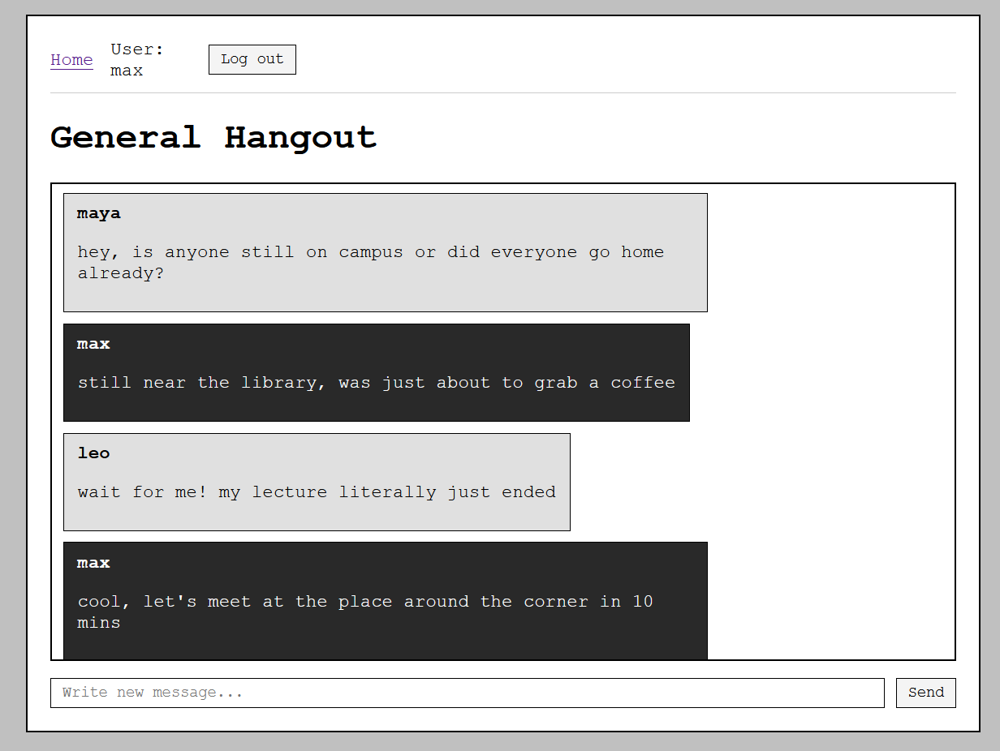

# Rails Chat App

A real-time, multi-room web chat application and RESTful JSON API built with **Ruby 3.4.5**, **Rails 8.1**, **PostgreSQL**, and **Hotwire (Turbo & Stimulus)**.

The web interface features a retro brutalist aesthetic (`Courier New` monospace typography, high-contrast borders) and uses Action Cable + Turbo Streams for live updates without full-page reloads.



## Architecture Highlights

* **Shared Broadcasts with Client-Side Personalization:** In Hotwire applications, `broadcast_append_to` sends the exact same HTML partial to every connected user in a room. To avoid rendering user-specific state on the server inside a shared WebSocket broadcast, this project embeds the current user's metadata (`current-user-id` and `current-user-admin`) in the layout `<head>` and uses lightweight Stimulus controllers (`message_controller.js` and `author_visibility_controller.js`) to dynamically style own vs. incoming messages and toggle room management controls on the client side.
* **Dual Authentication Flow:** Supports cookie-based session authentication via **Devise** for the web UI and stateless Bearer token authentication (`has_secure_token :api_token`) for the `/api` namespace.
* **Policy-Based Authorization:** Uses **Pundit** (`RoomPolicy`) across both HTML and API controllers so only a room's creator or an administrator (`role: :admin`) can rename or delete a room.
* **Centralized API Error Handling:** Uses an `ActiveSupport::Concern` (`ApiErrorHandling`) to translate `ActiveRecord::RecordNotFound`, `ActiveRecord::RecordInvalid`, and `Pundit::NotAuthorizedError` into standardized JSON error payloads with proper HTTP status codes (`404`, `422`, `403`).

---

## What It Has vs. What It Does Not Have

### Implemented Features (What It Has)
* **Real-Time Chat Rooms:** Create rooms, edit room names inline via **Turbo Frames**, and delete rooms with instant **Turbo Stream** updates across all connected browsers.
* **Live Messaging & Auto-Scroll:** Instant message broadcasting via Action Cable (`broadcast_append_to`) paired with a `MutationObserver`-based Stimulus controller (`scroll_controller.js`) that automatically scrolls the chat window to the newest message.
* **Role-Based Access Control:** `User` model supports `user` and `admin` roles via ActiveRecord enums, enforced by Pundit policies on the backend and reflected in the UI via Stimulus.
* **RESTful JSON API:** Endpoints for user registration, login, listing rooms, viewing room message history (with N+1 query prevention via `.includes(:user)`), creating rooms, and deleting rooms, serialized with **Blueprinter**.
* **Automated CI & Code Quality:** GitHub Actions pipeline running 4 parallel jobs (RSpec test suite against PostgreSQL 16, Brakeman static security analysis, Importmap JS vulnerability audit, and RuboCop Omakase linting) plus local **Overcommit** Git hooks.

### Current Scope Boundaries (What It Does Not Have)
To keep the project focused on clean backend patterns and Hotwire fundamentals, the following features are intentionally out of scope:
* **Direct 1-on-1 Private Messages:** All communication takes place in public rooms accessible to authenticated users.
* **Message Editing or Deletion:** Chat messages are append-only (`MessagesController#create`); moderation is handled at the room level.
* **Sending Messages via API:** The REST API currently covers authentication, room management, and reading room messages, while message creation is handled through the Hotwire web interface.
* **File/Media Attachments & Typing Indicators:** Messages are plain text only.

---

## Tech Stack

* **Backend:** Ruby 3.4.5, Ruby on Rails 8.1.2
* **Database & Rails 8 Solid Trifecta:** PostgreSQL 16, Solid Cable, Solid Cache, Solid Queue
* **Frontend:** Hotwire (Turbo Frames, Turbo Streams, Stimulus), Propshaft, Importmaps, Custom CSS
* **Authentication & Authorization:** Devise, Pundit, `has_secure_token` (API Bearer tokens)
* **JSON Serialization:** Blueprinter (`RoomBlueprint`, `MessageBlueprint`)
* **Testing & Quality:** RSpec, FactoryBot, Faker, RuboCop (`rubocop-rails-omakase`), Brakeman, Overcommit
* **Deployment & Containers:** Docker (multi-stage build with Thruster), Kamal

---

## How to Build & Run Locally

### Prerequisites
* **Ruby `3.4.5`** (`.ruby-version` and `.tool-versions` are included for `mise`, `asdf`, or `rbenv`)
* **PostgreSQL `16+`** running locally on port `5432`
* **Bundler**

### Step-by-Step Setup

**1. Clone the repository:**

```bash
git clone git@github.com:romanpelekh136/rails-chat-app.git
cd rails-chat-app
```

**2. Install dependencies:**

```bash
bundle install
```

**3. Create, migrate, and seed the PostgreSQL database:**

```bash
bin/rails db:prepare
bin/rails db:seed
```

**4. Start the development server:**

```bash
bin/dev
```

Open `localhost:3000` in your browser.

### Default Seeded Account
Running `bin/rails db:seed` creates 11 users and 5 sample chat rooms. You can log in immediately with:
* **Email:** `admin@example.com`
* **Password:** `password123`

---

## REST API Overview

All protected `/api` endpoints require an `Authorization: Bearer <api_token>` header.

| Method | Endpoint | Auth Required | Description |
| :--- | :--- | :--- | :--- |
| `POST` | `/api/register` | No | Register a new user (`email`, `username`, `password`, `password_confirmation`) and receive an `api_token`. |
| `POST` | `/api/login` | No | Authenticate with `email` and `password` to retrieve your `api_token`. |
| `GET` | `/api/rooms` | Yes | List all chat rooms ordered from newest to oldest. |
| `GET` | `/api/rooms/:id` | Yes | Fetch all messages inside a specific room ordered chronologically. |
| `POST` | `/api/rooms` | Yes | Create a new chat room (`{ "room": { "name": "Room Name" } }`). |
| `DELETE` | `/api/rooms/:id` | Yes | Delete a room (permitted only for the room creator or an admin; returns `403 Forbidden` otherwise). |

### Example API Requests

```bash
# 1. Log in to get your token
curl -X POST localhost:3000/api/login \
  -H "Content-Type: application/json" \
  -d '{"email": "admin@example.com", "password": "password123"}'

# 2. Fetch rooms using the returned token
curl localhost:3000/api/rooms \
  -H "Authorization: Bearer <YOUR_API_TOKEN>"
```

---

## Running Tests & Linters

```bash
# Run the RSpec test suite
bundle exec rspec

# Run RuboCop style checks
bin/rubocop

# Run Brakeman static security analysis
bin/brakeman

# Audit JavaScript importmap dependencies
bin/importmap audit
```